<!--
  Profile README for github.com/adityashroff06-code
  - Static cards in ./assets are generated by design/build.py (dark + light, fonts embedded).
  - Design system: "Obsidian & Gold", see design/README.md.
  - The GitHub pulse card and the contribution snake are rebuilt daily by
    .github/workflows/refresh-stats.yml and published to the `output` branch.
-->

<picture>
  <source media="(prefers-color-scheme: dark)" srcset="https://raw.githubusercontent.com/adityashroff06-code/adityashroff06-code/main/assets/hero-dark.svg">
  
</picture>

<a href="https://www.linkedin.com/in/aditya-shroff-8033a31b0/"><picture><source media="(prefers-color-scheme: dark)" srcset="https://raw.githubusercontent.com/adityashroff06-code/adityashroff06-code/main/assets/pill-linkedin-dark.svg"></picture></a>
&nbsp;
<a href="mailto:adityashroff06@gmail.com"><picture><source media="(prefers-color-scheme: dark)" srcset="https://raw.githubusercontent.com/adityashroff06-code/adityashroff06-code/main/assets/pill-email-dark.svg"></picture></a>

<picture>
  <source media="(prefers-color-scheme: dark)" srcset="https://raw.githubusercontent.com/adityashroff06-code/adityashroff06-code/main/assets/about-dark.svg">
  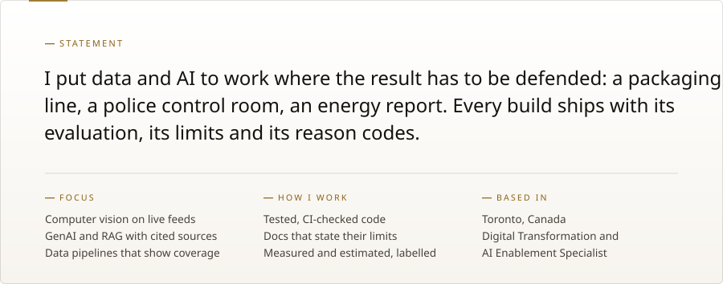
</picture>

 

<picture>
  <source media="(prefers-color-scheme: dark)" srcset="https://raw.githubusercontent.com/adityashroff06-code/adityashroff06-code/main/assets/case-capvision-dark.svg">
  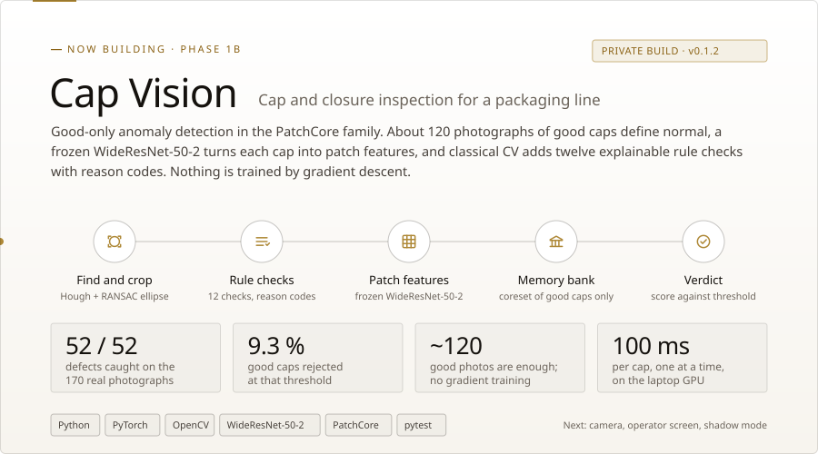
</picture>

<a href="https://github.com/adityashroff06-code/sentinel-gujarat"><picture><source media="(prefers-color-scheme: dark)" srcset="https://raw.githubusercontent.com/adityashroff06-code/adityashroff06-code/main/assets/case-sentinel-dark.svg">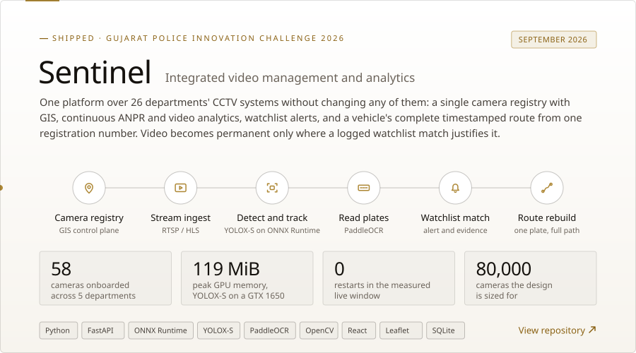</picture></a>

Hackathon submission as entered: <a href="https://github.com/adityashroff06-code/Sentinel_Repo"><code>Sentinel_Repo</code></a> &nbsp;·&nbsp; final structured build: <a href="https://github.com/adityashroff06-code/sentinel-gujarat"><code>sentinel-gujarat</code></a>

 

<picture>
  <source media="(prefers-color-scheme: dark)" srcset="https://raw.githubusercontent.com/adityashroff06-code/adityashroff06-code/main/assets/section-work-dark.svg">
  
</picture>

<a href="https://github.com/adityashroff06-code/EMS-Co-Pilot-"><picture><source media="(prefers-color-scheme: dark)" srcset="https://raw.githubusercontent.com/adityashroff06-code/adityashroff06-code/main/assets/project-ems-dark.svg">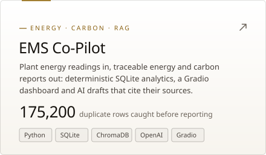</picture></a>
<a href="https://github.com/adityashroff06-code/YT-Summarizer---Gen-AI-Console"><picture><source media="(prefers-color-scheme: dark)" srcset="https://raw.githubusercontent.com/adityashroff06-code/adityashroff06-code/main/assets/project-briefing-dark.svg"></picture></a>

<a href="https://github.com/adityashroff06-code/Clean_Air_OS"><picture><source media="(prefers-color-scheme: dark)" srcset="https://raw.githubusercontent.com/adityashroff06-code/adityashroff06-code/main/assets/project-cleanair-dark.svg">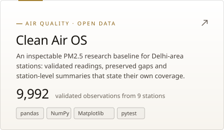</picture></a>
<a href="https://github.com/adityashroff06-code/Consumer-Segmentation-and-Purchase-Behavior-Analysis"><picture><source media="(prefers-color-scheme: dark)" srcset="https://raw.githubusercontent.com/adityashroff06-code/adityashroff06-code/main/assets/project-segmentation-dark.svg">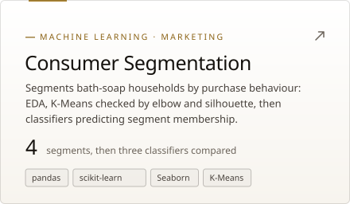</picture></a>

 

<picture>
  <source media="(prefers-color-scheme: dark)" srcset="https://raw.githubusercontent.com/adityashroff06-code/adityashroff06-code/main/assets/section-archive-dark.svg">
  
</picture>

<a href="https://github.com/adityashroff06-code/Company-Website"><picture><source media="(prefers-color-scheme: dark)" srcset="https://raw.githubusercontent.com/adityashroff06-code/adityashroff06-code/main/assets/row-productarmor-dark.svg">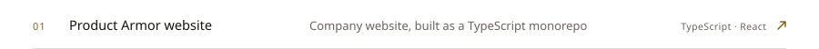</picture></a>
<picture><source media="(prefers-color-scheme: dark)" srcset="https://raw.githubusercontent.com/adityashroff06-code/adityashroff06-code/main/assets/row-mrdental-dark.svg">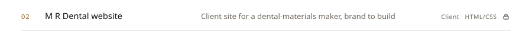</picture>
<a href="https://github.com/adityashroff06-code/POS-NER-Tagging"><picture><source media="(prefers-color-scheme: dark)" srcset="https://raw.githubusercontent.com/adityashroff06-code/adityashroff06-code/main/assets/row-posner-dark.svg">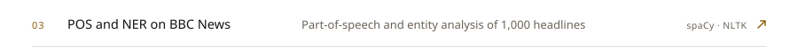</picture></a>
<a href="https://github.com/adityashroff06-code/IG_Clone_SQL_Assignment"><picture><source media="(prefers-color-scheme: dark)" srcset="https://raw.githubusercontent.com/adityashroff06-code/adityashroff06-code/main/assets/row-igsql-dark.svg"></picture></a>
<a href="https://github.com/adityashroff06-code/TEXT-PREPROCESSING-WITH-NLTK-AND-PANDAS"><picture><source media="(prefers-color-scheme: dark)" srcset="https://raw.githubusercontent.com/adityashroff06-code/adityashroff06-code/main/assets/row-textprep-dark.svg">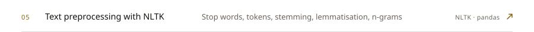</picture></a>
<a href="https://github.com/adityashroff06-code/Business-Web-and-Social-Media-Analysis"><picture><source media="(prefers-color-scheme: dark)" srcset="https://raw.githubusercontent.com/adityashroff06-code/adityashroff06-code/main/assets/row-webanalysis-dark.svg">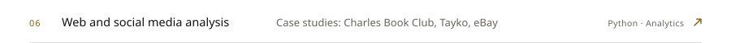</picture></a>

 

<picture>
  <source media="(prefers-color-scheme: dark)" srcset="https://raw.githubusercontent.com/adityashroff06-code/adityashroff06-code/main/assets/toolbox-dark.svg">
  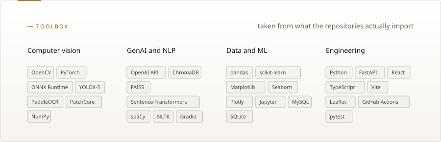
</picture>

 

<picture>
  <source media="(prefers-color-scheme: dark)" srcset="https://raw.githubusercontent.com/adityashroff06-code/adityashroff06-code/main/assets/section-pulse-dark.svg">
  
</picture>

<picture>
  <source media="(prefers-color-scheme: dark)" srcset="https://raw.githubusercontent.com/adityashroff06-code/adityashroff06-code/output/stats-dark.svg">
  
</picture>

<picture>
  <source media="(prefers-color-scheme: dark)" srcset="https://raw.githubusercontent.com/adityashroff06-code/adityashroff06-code/output/snake-dark.svg">
  
</picture>

 

<picture>
  <source media="(prefers-color-scheme: dark)" srcset="https://raw.githubusercontent.com/adityashroff06-code/adityashroff06-code/main/assets/footer-dark.svg">
  
</picture>

